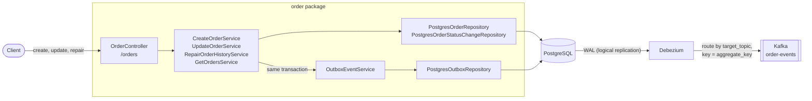
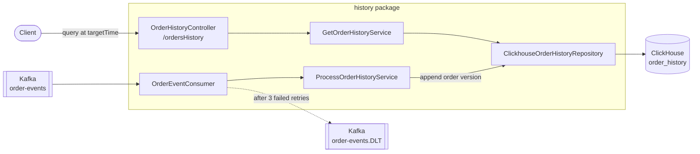

# Transactional Outbox Pattern with Spring Boot, Debezium, Kafka, and ClickHouse

This repository is a practical implementation of the **Transactional Outbox Pattern** built with a **Spring Boot + Kotlin** application. The project serves as an architectural blueprint for decoupled microservices, demonstrating how to securely manage data persistence and asynchronous event distribution without falling into the common pitfalls of distributed systems. The order history read model lives in **ClickHouse**, which supports point-in-time queries (time travel) over every version of an order.

## What Problem Am I Trying to Practice?

### The Business Scenario: Orders and Their History
The application manages orders. An order is created, changes its status (`CREATED`, `PROCESSING`, `COMPLETED`, `CANCELLED`), and can have its total amount corrected. PostgreSQL stores the current state of each order.

The order history keeps every version of each order in ClickHouse, so it can show how all orders looked at any point in time. The history is updated asynchronously from Kafka events, so writing an order does not depend on ClickHouse being available.

### The Architectural Problem: Dual Writes
Saving the order in PostgreSQL and then publishing an event to Kafka are two separate writes, and either can fail on its own:
* **Kafka fails after the database commit:** The order is saved, but the event is lost, so the history never sees the change.
* **The database fails after the event is sent:** The history records a change that was rolled back.

### The Solution: Transactional Outbox
1. The application writes the order change and an event row in the `outbox` table in **one PostgreSQL transaction**. Both are saved, or neither is.
2. **Debezium** reads the outbox rows from the PostgreSQL write-ahead log (WAL) and publishes them to Kafka.
3. The order history consumer reads the events and appends a new version of the order to ClickHouse. If the consumer is down, the events stay in Kafka until it recovers. Events that still fail after 3 retries go to a dead letter topic.

---

## Architecture Overview

**Write path:** from the order API to Kafka.



**Read path:** from Kafka to the order history API.



* **Write side (`order` package):** Stores orders and their status timeline in PostgreSQL and writes one outbox row per change in the same transaction.
* **Event routing:** The Debezium Outbox Event Router reads the `target_topic` column to choose the Kafka topic (`order-events`) and uses `aggregate_key` (the customer ID) as the message key.
* **Read side (`history` package):** Consumes the events and stores every order version in the ClickHouse `order_history` table (`ReplacingMergeTree`). The Kafka offset becomes the row version.

The application publishes four event types:

| Event                        | Trigger                            | Effect on the order history                                 |
|------------------------------|------------------------------------|-------------------------------------------------------------|
| `ORDER_CREATED`              | `POST /orders`                     | Appends the first version of the order                      |
| `ORDER_STATUS_UPDATED`       | `PUT /orders/status`               | Appends a new version with the new status                   |
| `ORDER_TOTAL_AMOUNT_UPDATED` | `PUT /orders/totalAmount`          | Corrects the amount in every version (lightweight `UPDATE`) |
| `ORDER_REPAIR`               | `POST /orders/{id}/history/repair` | Rebuilds every version from the PostgreSQL status timeline  |

---

## Technologies Used
The application stack is built entirely using containerized modern enterprise technologies:

* **Backend Framework:** Spring Boot 4 with **Kotlin** on Java 21
* **Transactional Database:** PostgreSQL 16
* **Analytical Database:** ClickHouse 26.8
* **Database Migrations:** Flyway
* **Message Broker:** Apache Kafka
* **Change Data Capture (CDC):** Debezium Connect 3.7 with the Outbox Event Router SMT
* **Infrastructure Orchestration:** Docker & Docker Compose

---

## How to Run the Application Locally

1. **Install Prerequisites**
   Ensure that **Java 21** (or compatible JDK) and **Docker Desktop / Engine** are installed and running on your machine.

2. **`./gradlew clean bootJar`**
   Compiles the Kotlin source code and generates the executable application archive inside the local build directory.

3. **`cd infra`**
   Navigates into the infrastructure folder containing the orchestrator configuration assets.

4. **`docker compose --profile app up --build -d`**
   Builds the application image and spins up the entire architectural service stack in the background. On the first start, the application inserts demo orders that flow through Debezium and Kafka into ClickHouse.

5. **Verify `http://localhost:8080/actuator/health`**
   Accesses the Spring Boot diagnostics interface to confirm the server, database, and broker connections are fully operational.

6. **Verify `http://localhost:8082`**
   Opens the Provectus Kafka UI control plane dashboard in your web browser to monitor topics and live event streams.

7. **Verify `http://localhost:8083/connectors/postgres-outbox-connector/status`**
   Queries the Debezium Connect REST API directly to verify that the connector and its task are `RUNNING`.

8. **Verify `http://localhost:8080/ordersHistory`**
   Returns the current order history from ClickHouse, including the demo orders.

9. **`docker compose --profile app down`**
   Stops and removes all running containers safely when you are finished developing.

10. **`docker compose --profile app down -v`**
    Stops the containers and permanently deletes the PostgreSQL and ClickHouse data volumes to trigger fresh Flyway migrations on the next run.

### Running the Application in IntelliJ IDEA
The `app` service belongs to the `app` Compose profile. Run `docker compose up -d` in the `infra` folder to start every service except the application, then run or debug the main class in IntelliJ. Set `APP_DEMO_DATA_ENABLED=true` in the run configuration to insert the demo orders. See [infra/README.md](infra/README.md) for details.

### Service Access Ports

| Service                  | Address                                                  |
|--------------------------|----------------------------------------------------------|
| Spring Boot Application  | `http://localhost:8080`                                  |
| Swagger UI               | `http://localhost:8080/swagger-ui.html`                  |
| Kafka UI                 | `http://localhost:8082`                                  |
| Kafka Connect REST API   | `http://localhost:8083/connectors`                       |
| PostgreSQL               | `localhost:5432` (`outbox_db`)                           |
| ClickHouse HTTP / native | `localhost:8123` / `localhost:9000` (`orders_analytics`) |
| Kafka (host listener)    | `localhost:9092`                                         |

---

## Documentation

* **Architecture Decision Records**
  * [ADR 0001: Outbox and CQRS](docs/adr/0001-architecture-decisions-for-outbox-and-cqrs.md)
  * [ADR 0002: Kafka Consumer Dead Letter Queue](docs/adr/0002-resilience-kafka-consumer-dlq.md)
  * [ADR 0003: ClickHouse for the Order History](docs/adr/0003-clickhouse-for-order-history.md)
* **Design Notes**
  * [ClickHouse Order History: Scenarios Explained](docs/design/clickhouse-order-history-scenarios.md)
* **Runbooks**
  * [ClickHouse Order History Scenarios](docs/runbook/clickhouse-order-history-scenarios.md)
  * [Kafka Poison Pill Handling](docs/runbook/kafka-poison-pill-handling.md)
* **Infrastructure**
  * [Docker Compose and IntelliJ Setup](infra/README.md)

---

## Code Style

Kotlin code style is enforced with [ktlint](https://pinterest.github.io/ktlint/) (rules configured in `.editorconfig`). `ktlintCheck` runs as part of `./gradlew check`.

* **`./gradlew ktlintCheck`** - Reports code style violations.
* **`./gradlew ktlintFormat`** - Automatically fixes code style violations.

---

## Troubleshooting & Useful Commands

* **`docker compose ps`**
  Displays the current operational state and port bindings of all containers to quickly verify which services are healthy or crashing.

* **ClickHouse log warnings**
  `Delay accounting is not enabled` and `Integrity check of the executable skipped` are harmless in the container: delay accounting depends on a kernel setting, and the official image may not include a reference checksum.

* **`docker compose logs app -f`**
  Tails the live log stream of the Spring Boot application (change `app` to `debezium`, `connector-init`, `kafka`, or `clickhouse` to inspect other services) to capture startup exceptions or connection failures.

* **`docker compose exec clickhouse --user ch_user --password ch_password -d orders_analytics`**
  Opens a ClickHouse SQL shell to inspect the raw rows of `order_history`, including every version of an order.

* **`docker compose build --no-cache`**
  Forces Docker to completely wipe out its internal build memory layers and download all script assets fresh, bypassing corrupted local caches.

* **`docker compose --profile app down -v`**
  Stops all running containers and permanently deletes the PostgreSQL and ClickHouse data volumes, allowing you to re-run Flyway migrations from scratch.

* **`curl http://localhost:8083/connectors/postgres-outbox-connector/status`**
  Queries the Debezium engine directly to check if your outbox connector has been registered successfully and is currently monitoring the database transaction log.

---

## Debezium Connector Configuration & Automation

To activate the Change Data Capture (CDC) pipeline, Debezium must be instructed to monitor the PostgreSQL `outbox` table by sending a JSON configuration to its REST API. The configuration lives in [`infra/debezium-outbox-connector.json`](infra/debezium-outbox-connector.json) and uses the Debezium Outbox Event Router SMT (Single Message Transform) to strip database replication metadata and stream only the event payload into the target Kafka topic.

The key settings are:

* **`table.include.list`:** `public.outbox`, the only table Debezium streams.
* **`topic.prefix`:** The logical server name (replaces `database.server.name` from Debezium 1.x).
* **`transforms.outbox.route.by.field`:** `target_topic`, so each outbox row chooses its Kafka topic.
* **`transforms.outbox.table.field.event.key`:** `aggregate_key`, the customer ID, which keeps the events of one customer in order on one partition.
* **`value.converter`:** `StringConverter`, because the `payload` column already holds the serialized JSON event.

The `connector-init` service in [`infra/docker-compose.yml`](infra/docker-compose.yml) registers the connector automatically. It waits for the Kafka Connect REST API, creates or updates the connector with an idempotent `PUT`, and fails if the connector task does not reach the `RUNNING` state.

To register the connector manually from the `infra` folder instead, run:
```bash
curl -X PUT -H "Content-Type: application/json" --data @debezium-outbox-connector.json http://localhost:8083/connectors/postgres-outbox-connector/config
```