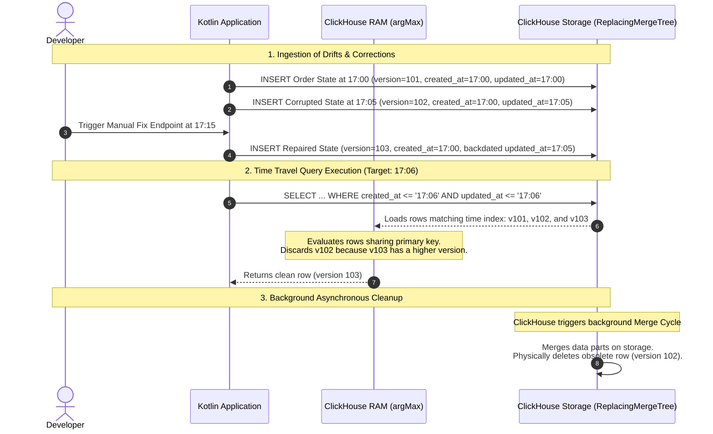

# ADR: ClickHouse Mutation & Optimization Strategies for Order History

## Status

Accepted

## Context

In our system, our transactional database (PostgreSQL) stores data in rows. This row-based structure makes changing a
single cell with an `UPDATE` or `DELETE` statement very fast. However, when PostgreSQL has to scan millions of rows to
calculate business metrics or historical trends, it slows down significantly.

To get fast analytics, we added **ClickHouse** as our analytical datastore (`OLAP`). ClickHouse compresses and
stores each column in its own separate file on disk. This columnar file structure makes reading specific fields
incredibly fast, but it makes changing data very slow. If you update a single value, ClickHouse must decompress the
whole column file, rewrite the data, and compress it back to disk.

To keep ClickHouse running at peak performance, we cannot use standard relational CRUD habits. Instead, we must write
code that relies on appending new data, targeting specific file folders, or using in-memory calculations. We need a
design that satisfies the following five specific core business requirements while ensuring that Historical
Point-in-Time Reconstruction (Time Travel) remains 100% accurate and operational across all of them:

1. **Order Creation:** Capture new orders streamed from Kafka instantly.
2. **Order Status Updates:** Track rapid operational state transitions (e.g., `CREATED` to `PROCESSING`) without causing
   database write blocks.
3. **Retroactive Data Corrections:** Correct financial data errors (e.g., `totalAmount` typos) in a way that modifies
   past records so that historical reporting remains accurate.
4. **Historical Point-in-Time Reconstruction (Time Travel):** Rebuild a clean snapshot of all orders exactly as they
   looked at any specific second in the past.
5. **History Rebuilds (Discrepancy Troubleshooting):** Provide an endpoint for developers to fix rare out-of-sync data
   discrepancies between PostgreSQL and ClickHouse manually.

---

## Decision

We chose to model our ClickHouse implementation by mapping each scenario to a specific optimization mechanism that
honors columnar storage constraints:

### Scenario 1: Order Creation

* **Options in ClickHouse:** Standard `INSERT` operation.
* **Our Choice: Direct Append-Only `INSERT`**.
* **Why we chose it:** Adding new data to the end of a column file is the fastest operation ClickHouse can do.
  ClickHouse writes the data block straight to disk without checking constraints or locking rows, keeping CPU and disk
  usage near zero. We map the row's `version` directly to the unique, incremental **Kafka Partition Message
  Offset** to establish an absolute ordering timeline.
* **Performance & Computational Cost:** **Near Zero.** Linear disk writes require minimal CPU and memory overhead
  because ClickHouse avoids transaction logs, constraints, and page locks.

### Scenario 2: Order Status Update (`CREATED` → `PROCESSING`)

* **Options in ClickHouse:**
    1. *Relational Approach:* Run a heavy SQL mutation
       (`UPDATE order_history SET status = 'PROCESSING' WHERE order_id = ...`).
    2. *Deduplication Approach:* Use the `ReplacingMergeTree` engine and insert changes as new rows.
* **Our Choice:** **Append-Only Ingestion via `ReplacingMergeTree` with `argMax()` memory aggregation**.
* **Why we chose it:** A traditional `UPDATE` query triggers an expensive database mutation that slows down ingestion.
  Instead, we use the **`ReplacingMergeTree(version)`** engine. We **insert a new row** with the new
  status and a higher version number (the next Kafka offset). ClickHouse handles this as a cheap, instant
  insert. The sorting key `ORDER BY (customer_id, order_id, updated_at)` includes the time of each status change, so
  every state of the order is a distinct row that background merges **keep**; this is what makes time travel possible.
  Merges only remove rows that share the full key, i.e. the same `updated_at`: Kafka redeliveries and the corrupted
  rows replaced by a backdated rebuild (Scenario 5). Because `ReplacingMergeTree` only deduplicates rows inside the
  same partition, the table is partitioned by the immutable order creation time `toYYYYMM(created_at)`, so every
  version of an order lands in the same partition. To read the latest status, our repository uses a fast in-memory
  aggregation query instead of the heavy `FINAL` keyword:
  ```sql
  SELECT order_id, argMax(status, version) AS status FROM order_history GROUP BY order_id;
  ```
* **Performance & Computational Cost:** **Low Write Cost / Low-to-Medium Read Cost.** Ingestion remains instantaneous
  since updates are treated as raw inserts. Reads incur a minor CPU overhead during query execution because
  ClickHouse must collapse row versions in memory using RAM aggregation.

### Scenario 3: Retroactive Total Amount Correction

* **Options in ClickHouse:**
    1. *Classic Mutation Structure:* Run an `ALTER TABLE ... UPDATE` statement to force a physical column file rewrite
       on disk.
    2. *Lightweight Update Patching:* Run a standard `UPDATE ... SET` query to generate highly compressed "patch
       parts".
* **Our Choice:** **Lightweight Update Patching**.
* **Why we chose it:** To avoid the computational heavy-lifting of re-compressing entire column files on disk, we
  utilize ClickHouse's native lightweight updates. Because human data corrections are low-volume anomalies
  impacting less than 1% of the total dataset, creating tiny patch deltas is drastically more efficient than initiating
  global background table mutations. We use a standard SQL `UPDATE` statement and enforce a **strict partition
  rule** in our Kotlin repository code to optimize indexing:
  ```sql
  UPDATE order_history 
  SET total_amount = ? 
  WHERE customer_id = ? AND order_id = ?
    AND created_at >= :partitionStart AND created_at < :partitionEnd; -- Limits the patch to one partition
  ```
* **Time Travel Verification:** Because patch parts link directly to target rows, they honor the primary key and
  historical indexes. Any point-in-time evaluation automatically applies the active patch, ensuring financial reporting
  accuracy remains impeccable.
* **Performance & Computational Cost:** **Low Write Cost / Minor Read Overhead.** Writing a patch part happens instantly
  without impacting ingestion pipelines. Time travel read operations absorb a very minor computation penalty to stitch
  column deltas together in RAM before background data merges complete.

### Scenario 4: Historical Point-in-Time Reconstruction (Time Travel)

* **Options in ClickHouse:**
    1. *Application-Level Filtering:* Pull all duplicate historical records into Kotlin and filter them in memory.
    2. *Database-Level Merging (`FINAL`):* Use `SELECT * FROM order_history FINAL WHERE updated_at <= ?`.
    3. *Index Aggregation:* Use a timestamp filter with an in-memory `argMax` group operation.
* **Our Choice:** **Timestamp Filter with Memory-Based `argMax` Aggregation**.
* **Why we chose it:** Pulling raw duplicates into Kotlin destroys network bandwidth, and the `FINAL` modifier forces
  heavy disk merges at runtime. By combining a `WHERE created_at <= ? AND updated_at <= ?` clause with
  `GROUP BY order_id` and `argMax(column, version)`, ClickHouse drops unwanted future time segments instantly: the
  `created_at` filter prunes whole monthly partitions of orders that did not exist yet, and the `updated_at` filter
  removes state changes that happened after the target time. It then collapses duplicate rows directly in RAM, returning
  a clean, lightweight list containing
  only one row per order.
* **Performance & Computational Cost:** **Medium Read Cost.** The query utilizes primary keys and columnar index
  structures to drop unwanted time slices instantly from disk. Processing data grouping and version selection
  requires temporary RAM allocation during execution.

### Scenario 5: History Rebuilds (Discrepancy Troubleshooting)

* **Options in ClickHouse:**
    1. *Append-Only Re-injection with Higher Version:* Insert the correct data directly from PostgreSQL using an
       incremented `version` value but preserving the original historical timestamps.
    2. *Atomic Replacement via Temporary Partition:* Load clean data into a buffer table and swap files using
       `ALTER TABLE ... REPLACE PARTITION`.
* **Our Choice:** **Append-Only Re-injection with Higher Version**.
* **Why we chose it:** Wiping a full month folder via metadata (`DROP PARTITION`) is too destructive if only a few rows
  suffer from data drift. Atomic replacement via temporary partitions requires managing buffer schemas, which adds
  unnecessary structural complexity. Append-only re-injection avoids row deletions entirely by turning the fix into a
  standard, zero-overhead `INSERT`.
* **Performance & Computational Cost:** **Low Write Cost / Zero Deletion Overhead.** This approach introduces zero
  storage duplication and zero immediate deletion costs. The computational overhead is identical to standard
  append ingestion, deferring physical row removal to automated background merge tasks.

---

## Deep Dive: Time Travel & Data Lifecycle per Scenario

### Shared Foundation: The Three Columns That Drive Time Travel

Every row in `order_history` is one immutable version of an order. Three columns decide which version a query returns:

| Column       | Meaning                                                      | Set once per order? | Role in the query                                                           |
|:-------------|:-------------------------------------------------------------|:--------------------|:----------------------------------------------------------------------------|
| `created_at` | When the order was created.                                  | Yes (immutable)     | Partition key `toYYYYMM(created_at)`; prunes orders that did not exist yet. |
| `updated_at` | When the state stored in this row became valid.              | No, one per version | Time travel filter and part of the sorting key; keeps every state on disk.  |
| `version`    | Kafka offset of the event (or a higher value for a rebuild). | No, one per version | Tie-breaker; `argMax(column, version)` keeps the newest remaining version.  |

For an order creation, `updated_at` equals `created_at`. Because `created_at` never changes, every version of an order
lands in the same monthly partition. `updated_at` is part of the sorting key `(customer_id, order_id, updated_at)`, so
`ReplacingMergeTree` only merges rows that describe the **same point in time** of an order and never deletes earlier
states.

All snapshots below are produced by `ClickhouseOrderHistoryRepository.findBefore(targetTime)` (see its KDoc). The query
works in three steps:

1. `created_at <= targetTime` skips whole monthly partitions of orders that did not exist yet.
2. `updated_at <= targetTime` drops the versions that happened after the target time.
3. `GROUP BY order_id` with `argMax(column, version)` keeps the newest remaining version of each order.

### Scenario 2: Order Status Update

An order is created at `17:00` and moves to `PROCESSING` at `17:05`. Each event is appended as a new row; nothing is
updated in place.

**Stored rows:**

| Version | `created_at` | `updated_at` | `status`     | `total_amount` | Meaning        |
|:--------|:-------------|:-------------|:-------------|:---------------|:---------------|
| `v101`  | `17:00`      | `17:00`      | `CREATED`    | `99.00`        | Order creation |
| `v102`  | `17:00`      | `17:05`      | `PROCESSING` | `99.00`        | Status update  |

**Resolution per snapshot:**

| Snapshot | Step 1: `created_at <= target`        | Step 2: `updated_at <= target` | Step 3: `argMax(..., version)` | Result       |
|:---------|:--------------------------------------|:-------------------------------|:-------------------------------|:-------------|
| `16:59`  | No row passes (order not created yet) | –                              | –                              | Order absent |
| `17:02`  | `v101`, `v102`                        | `v101`                         | `v101`                         | `CREATED`    |
| `17:06`  | `v101`, `v102`                        | `v101`, `v102`                 | `v102` (`102 > 101`)           | `PROCESSING` |

Step 1 never chooses between versions of an order, since all of them share the same `created_at`. It only lets
ClickHouse skip whole monthly partitions of orders created after the target time. The choice between versions happens
in step 2 (which versions already existed) and step 3 (which of them is the newest).

#### Storage Lifecycle

`v101` is **not** obsolete: it is the only row that can answer the `17:02` snapshot. Background merges keep it, because
`v101` and `v102` have different `updated_at` values and therefore different sorting keys. If the sorting key were only
`(customer_id, order_id)`, a merge would keep `v102` alone and the `17:02` snapshot would return no order at all.

Merges only remove true duplicates, i.e. rows with the same `updated_at`: for example, a Kafka redelivery of `v102`
(same version, removed) or a corrupted row replaced by a backdated rebuild (Scenario 5). The integration test
`ClickhouseOrderEventConsumerIT` forces a merge with `OPTIMIZE TABLE order_history FINAL` and verifies that the
`CREATED` state is still returned afterwards.

### Scenario 3: Retroactive Total Amount Correction

At `17:15` we notice that the order from Scenario 2 was entered with `total_amount = 99.00` instead of `9.90`. The
wrong value was never true, so the correction must apply to **every** past snapshot, while the status timeline stays
unchanged.

#### Why Append-Only Does Not Work Here

Every event carries the full order state, so the typo was copied into **every version** of the order history: both
`v101` (`CREATED`) and `v102` (`PROCESSING`) hold `99.00`. An appended row corrects only **one** version, the one it
replaces in `argMax`, but not the whole order history:

| Appended correction row                    | Snapshot `17:02` | Snapshot `17:06`          | Problem                                       |
|:-------------------------------------------|:-----------------|:--------------------------|:----------------------------------------------|
| `v103`, `PROCESSING`, `updated_at` `17:15` | `v101`: `99.00`  | `v102`: `99.00`           | Every snapshot before `17:15` keeps the typo. |
| `v103`, `CREATED`, backdated to `17:00`    | `v103`: `9.90`   | `v103`: `CREATED`, `9.90` | Fixes the amount, but overrides `PROCESSING`. |

To fix the whole order history by appending, every version needs its own corrected row, with a version number
higher than the version it corrects but lower than the next version of the same order (`101 < v < 102`). Kafka
offsets are counted per partition, so events of other orders usually leave numbers free between two versions of
the same order. However, this is not a reliable versioning strategy:

* The size of each gap depends on the traffic in the partition; it is zero when two events of the order were
  consecutive.
* An order with several versions needs a free number after **each** of them, and every further correction of the
  same version consumes another number from the same gap.

Supporting unlimited corrections would require a version scheme that is independent of the Kafka offset. The
lightweight update avoids version numbers altogether, so it is the approach we test for this scenario.

#### Why Lightweight Update Works

A single lightweight update patches the amount in **all** versions of the order at once. All versions share the same
`created_at`, so the statement touches exactly one partition:

```sql
UPDATE order_history
SET total_amount = ?
WHERE customer_id = ? AND order_id = ?
  AND created_at >= :partitionStart
  AND created_at < :partitionEnd;
```

**Stored rows after the patch:**

| Version | `created_at` | `updated_at` | `status`     | `total_amount` |
|:--------|:-------------|:-------------|:-------------|:---------------|
| `v101`  | `17:00`      | `17:00`      | `CREATED`    | `9.90`         |
| `v102`  | `17:00`      | `17:05`      | `PROCESSING` | `9.90`         |

**Resolution per snapshot:**

| Snapshot | Resolved version | Result               |
|:---------|:-----------------|:---------------------|
| `17:02`  | `v101`           | `CREATED`, `9.90`    |
| `17:06`  | `v102`           | `PROCESSING`, `9.90` |

`status`, `updated_at` and `version` stay untouched, so the status timeline from Scenario 2 is preserved. The
trade-off is that ClickHouse no longer keeps the original wrong value, and corrections must stay low-frequency (see
Negative Impact).

### Scenario 5: History Rebuild with Backdated Versions

When a developer triggers a manual history rebuild for specific records, the system preserves the historical integrity
of the timeline by inserting the correct state with a higher version number, but explicitly forcing the original
historical timestamp into the `updated_at` field. The order creation time `created_at` stays unchanged.

Suppose an order is created at `17:00` (`version 101`) and receives a corrupted status entry at `17:05`
(`version 102`). The developer triggers the troubleshooting endpoint at `17:15`, which inserts the repaired record with
`version 103`. The repaired row does **not** use the insertion time `17:15`. It copies the `updated_at` of the row it
repairs (`17:05`), so it replaces that state at the same point of the timeline.

**Stored rows:**

| Version | `created_at` | `updated_at`        | `status`     | Inserted at | Meaning                |
|:--------|:-------------|:--------------------|:-------------|:------------|:-----------------------|
| `v101`  | `17:00`      | `17:00`             | `CREATED`    | `17:00`     | Correct initial state  |
| `v102`  | `17:00`      | `17:05`             | `COMPLETED`  | `17:05`     | Corrupted status drift |
| `v103`  | `17:00`      | `17:05` (backdated) | `PROCESSING` | `17:15`     | Repair from rebuild    |

**Resolution per snapshot:**

| Snapshot | Step 1: `created_at <= target`        | Step 2: `updated_at <= target` | Step 3: `argMax(..., version)` | Result                  |
|:---------|:--------------------------------------|:-------------------------------|:-------------------------------|:------------------------|
| `16:59`  | No row passes (order not created yet) | –                              | –                              | Order absent            |
| `17:02`  | `v101`, `v102`, `v103`                | `v101`                         | `v101`                         | `CREATED` (correct)     |
| `17:06`  | `v101`, `v102`, `v103`                | `v101`, `v102`, `v103`         | `v103` (`103 > 102`)           | `PROCESSING` (repaired) |
| `17:20`  | `v101`, `v102`, `v103`                | `v101`, `v102`, `v103`         | `v103`                         | `PROCESSING` (repaired) |

#### Why the Repair Must Be Backdated

If the rebuild stored its real insertion time (`updated_at = 17:15`), the timeline would be wrong for every snapshot
between the corruption and the repair:

| Snapshot | Rows after step 2      | `argMax` result | Result                                     |
|:---------|:-----------------------|:----------------|:-------------------------------------------|
| `17:06`  | `v101`, `v102`         | `v102`          | `COMPLETED` (**corrupted state returned**) |
| `17:20`  | `v101`, `v102`, `v103` | `v103`          | `PROCESSING` (correct only after `17:15`)  |

Backdating makes the repair replace the corrupted state from the moment the corruption happened. It also gives `v103`
the same sorting key `(customer_id, order_id, updated_at)` as `v102`, so the next background merge physically removes
the corrupted `v102` and keeps `v101` and `v103`.

**Rules for the rebuild endpoint:**

* `created_at` is copied unchanged from the existing rows of the order.
* `updated_at` is copied from the row being repaired, never set to the current time.
* `version` must be higher than the version of the repaired row, but lower than any version that happened after it.
  Otherwise the repair would also override later, correct state changes in every snapshot after them. Kafka offsets
  often leave a gap between two versions of the same order, but its size is not guaranteed (see Scenario 3). The
  rebuild therefore only repairs the **latest** version of an order, using `max(version) + 1`, which needs no gap.

#### Data Lifecycle & Query Resolution Flow



---

## Consequences

### Positive Impact

* **Accurate Time Travel:** Every state change is kept as its own row (`updated_at` in the sorting key), so snapshots
  return the state valid at the target time, including retroactive amount corrections and backdated rebuilds.
* **High Write Throughput:** Order creation, status updates and rebuilds are plain inserts without row locks or
  mutations.
* **Fast Reporting Without `FINAL`:** Snapshots prune partitions by `created_at` and resolve versions in memory with
  `argMax`.
* **Non-Blocking Troubleshooting:** Rebuilds are inserts and do not block ingestion or reads.

### Negative Impact

* **Growing Storage per Order:** Every status change is kept as its own row to enable time travel, so storage grows
  with the number of state changes, not with the number of orders. Only true duplicates (same `updated_at`) are
  removed by background merges.
* **Growing Read Cost:** `argMax` aggregates all versions of an order up to the target time, so the cost of a snapshot
  grows with the number of status changes.
* **Patch Part Accumulation (Scenario 3):** Each lightweight `UPDATE` creates a patch part that reads must apply until a
  background merge folds it into the data parts. Frequent corrections increase read overhead and merge load, so
  corrections must remain low-frequency events.
* **Beta Feature Dependency (Scenario 3):** Lightweight updates are a beta feature since ClickHouse 25.8 and require the
  table settings `enable_block_number_column` and `enable_block_offset_column`. ClickHouse upgrades must be checked for
  changes to this feature.
* **Version Coupled to Kafka Offsets:** Ordering per order relies on all its events sharing one partition (keyed by
  `customer_id`). Offsets restart if the topic is recreated, and rebuilds can only repair the latest version of an
  order (see Scenario 5).

---

## TL;DR

| Scenario             | Our Goal                 | Technical Pattern We Chose                 | Why It Performs Better                                                                                                                                                                                                                              |
|:---------------------|:-------------------------|:-------------------------------------------|:----------------------------------------------------------------------------------------------------------------------------------------------------------------------------------------------------------------------------------------------------|
| **1. Creation**      | Fast data intake         | **`INSERT`**                               | **Append-Only Speed:** Writes data directly to the end of files without checking row constraints.                                                                                                                                                   |
| **2. Status Update** | Real-time tracking       | **`ReplacingMergeTree` + `argMax()`**      | **No Database Locks:** Converts slow updates into instant inserts that keep every state (`updated_at` in the sorting key) and resolves the current state in memory during reads.                                                                     |
| **3. Correction**    | Accurate Time Travel     | **`UPDATE ... SET` (Lightweight Update)**  | **Patch-on-Read Delta:** Drops write costs to near-zero by writing tiny delta patches, merging them into main columns later during background maintenance.                                                                                          |
| **4. Time Travel**   | Past snapshot auditing   | **`WHERE` Timestamp + `argMax()`**         | **In-Memory Aggregation:** Uses index filtering to drop unwanted records fast and collapses versions in RAM.                                                                                                                                        |
| **5. Rebuild**       | Resolve out-of-sync data | **Append-Only Re-injection (`INSERT` v+)** | **Zero Deletion Cost + Accurate Time Travel:** Inserts the true record with a higher version number backdated to the original event timestamp. Resolves drift instantly in RAM and delegates physical disk cleanup to ClickHouse background merges. |
