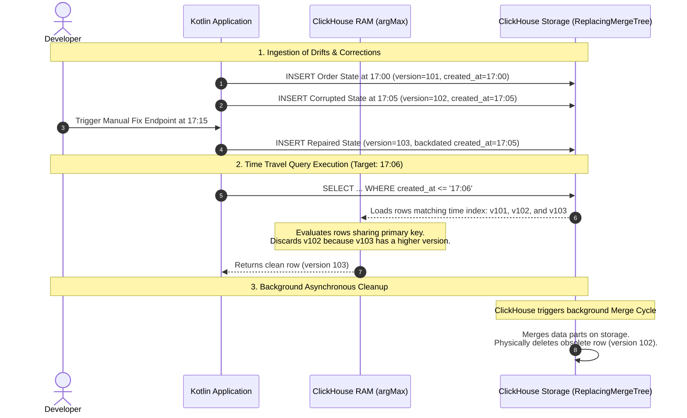

# ADR: ClickHouse Mutation & Optimization Strategies for Order History

## Status

Accepted

## Context

In our system, our transactional database (PostgreSQL) stores data in rows. This row-based structure makes changing a
single cell with an `UPDATE` or `DELETE` statement very fast. However, when PostgreSQL has to scan millions of rows to
calculate business metrics or historical trends, it slows down significantly.

To get fast analytics, we added **ClickHouse** as our analytical datastore (`OLAP`). ClickHouse compresses and
stores each column in its own separate file on disk. This columnar file structure makes reading specific fields
incredibly fast, but it makes changing data very slow. If you update a single value, ClickHouse must decompress the
whole column file, rewrite the data, and compress it back to disk.

To keep ClickHouse running at peak performance, we cannot use standard relational CRUD habits. Instead, we must write
code that relies on appending new data, targeting specific file folders, or using in-memory calculations. We need a
design that satisfies the following five specific core business requirements while ensuring that Historical
Point-in-Time Reconstruction (Time Travel) remains 100% accurate and operational across all of them:

1. **Order Creation:** Capture new orders streamed from Kafka instantly.
2. **Order Status Updates:** Track rapid operational state transitions (e.g., `CREATED` to `PROCESSING`) without causing
   database write blocks.
3. **Retroactive Data Corrections:** Correct financial data errors (e.g., `totalAmount` typos) in a way that modifies
   past records so that historical reporting remains accurate.
4. **Historical Point-in-Time Reconstruction (Time Travel):** Rebuild a clean snapshot of all orders exactly as they
   looked at any specific second in the past.
5. **History Rebuilds (Discrepancy Troubleshooting):** Provide an endpoint for developers to fix rare out-of-sync data
   discrepancies between PostgreSQL and ClickHouse manually.

---

## Decision

We chose to model our ClickHouse implementation by mapping each scenario to a specific optimization mechanism that
honors columnar storage constraints:

### Scenario 1: Order Creation

* **Options in ClickHouse:** Standard `INSERT` operation.
* **Our Choice: Direct Append-Only `INSERT`**.
* **Why we chose it:** Adding new data to the end of a column file is the fastest operation ClickHouse can do.
  ClickHouse writes the data block straight to disk without checking constraints or locking rows, keeping CPU and disk
  usage near zero. We map the row's `version` directly to the unique, incremental **Kafka Partition Message
  Offset** to establish an absolute ordering timeline.
* **Performance & Computational Cost:** **Near Zero.** Linear disk writes require minimal CPU and memory overhead
  because ClickHouse avoids transaction logs, constraints, and page locks.

### Scenario 2: Order Status Update (`CREATED` → `PROCESSING`)

* **Options in ClickHouse:**
    1. *Relational Approach:* Run a heavy SQL mutation
       (`UPDATE order_history SET status = 'PROCESSING' WHERE order_id = ...`).
    2. *Deduplication Approach:* Use the `ReplacingMergeTree` engine and insert changes as new rows.
* **Our Choice:** **Append-Only Ingestion via `ReplacingMergeTree` with `argMax()` memory aggregation**.
* **Why we chose it:** A traditional `UPDATE` query triggers an expensive database mutation that slows down ingestion.
  Instead, we use the **`ReplacingMergeTree(version)`** engine. We simply **insert a new row** with the new
  status and a higher version number (the next Kafka offset). ClickHouse handles this as a cheap, instant
  insert. Later, ClickHouse automatically cleans up old rows sharing the same sorting key
  `ORDER BY (customer_id, order_id)` in the background. To ensure our application reads the latest status
  immediately before the disk merge happens, our repository uses a fast in-memory aggregation query instead of the heavy
  `FINAL` keyword.:
  ```sql
  SELECT order_id, argMax(status, version) AS status FROM order_history GROUP BY order_id;
  ```
* **Performance & Computational Cost:** **Low Write Cost / Low-to-Medium Read Cost.** Ingestion remains instantaneous
  since updates are treated as raw inserts. Reads incur a minor CPU overhead during query execution because
  ClickHouse must collapse row versions in memory using RAM aggregation.

### Scenario 3: Retroactive Total Amount Correction

* **Options in ClickHouse:**
    1. *Classic Mutation Structure:* Run an `ALTER TABLE ... UPDATE` statement to force a physical column file rewrite
       on disk.
    2. *Lightweight Update Patching:* Run a standard `UPDATE ... SET` query to generate highly compressed "patch
       parts".
* **Our Choice:** **Lightweight Update Patching**.
* **Why we chose it:** To avoid the computational heavy-lifting of re-compressing entire column files on disk, we
  utilize ClickHouse's native lightweight updates. Because human data corrections are low-volume anomalies
  impacting less than 1% of the total dataset, creating tiny patch deltas is drastically more efficient than initiating
  global background table mutations. We use a standard SQL `UPDATE` statement and enforce a **strict partition
  rule** in our Kotlin repository code to optimize indexing:
  ```sql
  UPDATE order_history 
  SET total_amount = ? 
  WHERE order_id = ? AND created_at >= partition_start_boundary; -- Limits patch part evaluation scope
  ```
* **Time Travel Verification:** Because patch parts link directly to target rows, they honor the primary key and
  historical indexes. Any point-in-time evaluation automatically applies the active patch, ensuring financial reporting
  accuracy remains impeccable.
* **Performance & Computational Cost:** **Low Write Cost / Minor Read Overhead.** Writing a patch part happens instantly
  without impacting ingestion pipelines. Time travel read operations absorb a very minor computation penalty to stitch
  column deltas together in RAM before background data merges complete.

### Scenario 4: Historical Point-in-Time Reconstruction (Time Travel)

* **Options in ClickHouse:**
    1. *Application-Level Filtering:* Pull all duplicate historical records into Kotlin and filter them in memory.
    2. *Database-Level Merging (`FINAL`):* Use `SELECT * FROM order_history FINAL WHERE created_at <= ?`.
    3. *Index Aggregation:* Use a timestamp filter with an in-memory `argMax` group operation.
* **Our Choice:** **Timestamp Filter with Memory-Based `argMax` Aggregation**.
* **Why we chose it:** Pulling raw duplicates into Kotlin destroys network bandwidth, and the `FINAL` modifier forces
  heavy disk merges at runtime. By combining a `WHERE created_at <= ?` clause with `GROUP BY order_id` and
  `argMax(column, version)`, ClickHouse drops unwanted future time segments instantly using its columnar
  indexes. It then collapses duplicate rows directly in RAM, returning a clean, lightweight list containing
  only one row per order.
* **Performance & Computational Cost:** **Medium Read Cost.** The query utilizes primary keys and columnar index
  structures to drop unwanted time slices instantly from disk. Processing data grouping and version selection
  requires temporary RAM allocation during execution.

### Scenario 5: History Rebuilds (Discrepancy Troubleshooting)

* **Options in ClickHouse:**
    1. *Append-Only Re-injection with Higher Version:* Insert the correct data directly from PostgreSQL using an
       incremented `version` value but preserving the original historical timestamps.
    2. *Atomic Replacement via Temporary Partition:* Load clean data into a buffer table and swap files using
       `ALTER TABLE ... REPLACE PARTITION`.
* **Our Choice:** **Append-Only Re-injection with Higher Version**.
* **Why we chose it:** Wiping a full month folder via metadata (`DROP PARTITION`) is too destructive if only a few rows
  suffer from data drift. Atomic replacement via temporary partitions requires managing buffer schemas, which adds
  unnecessary structural complexity. Append-only re-injection avoids row deletions entirely by turning the fix into a
  standard, zero-overhead `INSERT`.
* **Performance & Computational Cost:** **Low Write Cost / Zero Deletion Overhead.** This approach introduces zero
  storage duplication and zero immediate deletion costs. The computational overhead is identical to standard
  append ingestion, deferring physical row removal to automated background merge tasks.

---

## Deep Dive: Time Travel & Data Lifecycle Verification (Scenario 5)

When a developer triggers a manual history rebuild for specific records, the system preserves the historical integrity
of the timeline by inserting the correct state with a higher version number, but explicitly forcing the original
historical timestamp into the `created_at` field.

### How ClickHouse Resolves the Timeline

Suppose an order has a correct entry at `17:00` (`version 101`) and a corrupted status entry at `17:05` (`version 102`).
The developer triggers the troubleshooting endpoint at `17:15`, inserting the repaired record with `version 103`
backdated to `17:05`.

* **Querying a snapshot at `17:02` (`WHERE created_at <= '17:02'`):** The database filters out both the corrupted entry
  and the fix because their timestamps are higher than the threshold. The engine evaluates only the `17:00` row (`v101`)
  and returns the correct initial state.
* **Querying a snapshot at `17:06` (`WHERE created_at <= '17:06'`):** The database pulls the rows from `17:00` (`v101`),
  `17:05` (`v102`), and the backdated correction row (`v103`). Because our repository runs `argMax(status, version)`,
  ClickHouse compares the versions in RAM, evaluates that `103 > 102`, and returns the perfect repaired record while
  ignoring the drift.

### Storage Lifecycle

This approach means **we hold obsolete data (`version 102`) on the hard drive for a short period of time**.
However, this does not affect query accuracy or performance since `argMax` filters duplicates instantly in
memory. Eventually, **ClickHouse cleans up these obsolete records automatically** during asynchronous
background partition merge cycles, purging the old rows from disk without manual intervention.

### Data Lifecycle & Query Resolution Flow



---

## Consequences

### Positive Impact

* **100% Reliable Time Travel:** Every technical pattern guarantees that point-in-time queries return true, uncorrupted
  historical states matching business reality.
* **Extreme Write Throughput:** Ingesting status progressions and manual troubleshooting fixes uses cheap inserts,
  ensuring the stream pipeline handles high traffic without locks.
* **Blazing-Fast Reporting:** Reconstructing historical snapshots takes milliseconds because operations happen via fast
  in-memory aggregation.
* **Zero Disruption Troubleshooting:** Developers can fix data discrepancies instantly via `INSERT` commands without
  locking tables or blocking production read/write operations.

### Negative Impact

* **Temporary Disk Overhead:** Duplicate rows exist on the raw disk space until ClickHouse runs its background merge
  cycles (this is mitigated entirely by using `argMax` in our query models).
* **Mutation Queue Risks:** If the application triggers thousands of retroactive `ALTER TABLE UPDATE` commands per
  second (Scenario 3), the ClickHouse background queue will saturate. Data corrections must remain low-frequency events.

---

## TL;DR

| Scenario             | Our Goal                 | Technical Pattern We Chose                 | Why It Performs Better                                                                                                                                                                                                                              |
|:---------------------|:-------------------------|:-------------------------------------------|:----------------------------------------------------------------------------------------------------------------------------------------------------------------------------------------------------------------------------------------------------|
| **1. Creation**      | Fast data intake         | **`INSERT`**                               | **Append-Only Speed:** Writes data directly to the end of files without checking row constraints.                                                                                                                                                   |
| **2. Status Update** | Real-time tracking       | **`ReplacingMergeTree` + `argMax()`**      | **No Database Locks:** Converts slow updates into instant inserts and resolves duplicates in memory during reads.                                                                                                                                   |
| **3. Correction**    | Accurate Time Travel     | **`UPDATE ... SET` (Lightweight Update)**  | **Patch-on-Read Delta:** Drops write costs to near-zero by writing tiny delta patches, merging them into main columns later during background maintenance.                                                                                          |
| **4. Time Travel**   | Past snapshot auditing   | **`WHERE` Timestamp + `argMax()`**         | **In-Memory Aggregation:** Uses index filtering to drop unwanted records fast and collapses versions in RAM.                                                                                                                                        |
| **5. Rebuild**       | Resolve out-of-sync data | **Append-Only Re-injection (`INSERT` v+)** | **Zero Deletion Cost + Accurate Time Travel:** Inserts the true record with a higher version number backdated to the original event timestamp. Resolves drift instantly in RAM and delegates physical disk cleanup to ClickHouse background merges. |
