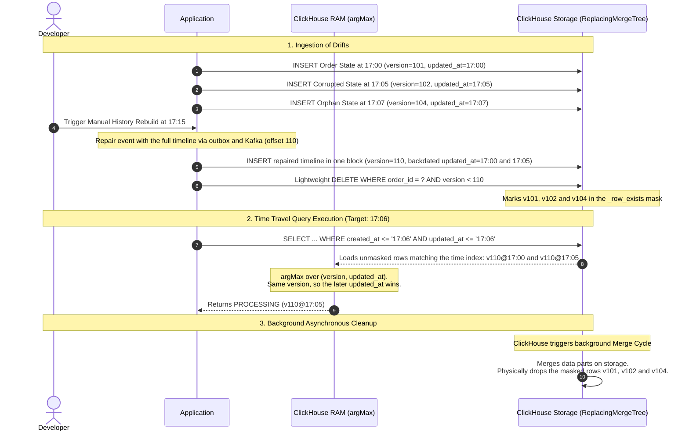

# ClickHouse Order History: Scenarios Explained

This design note explains the decisions of
[ADR 0003: ClickHouse Mutation & Optimization Strategies for Order History](../adr/0003-clickhouse-for-order-history.md)
with worked examples. It shows, per scenario, which rows are stored and how each time travel snapshot resolves them.
The ADR records the decisions, their alternatives and their consequences; this note shows how they behave.

## Shared Foundation: The Three Columns That Drive Time Travel

Every row in `order_history` is one immutable version of an order. Three columns decide which version a query returns:

| Column       | Meaning                                                      | Set once per order? | Role in the query                                                           |
|:-------------|:-------------------------------------------------------------|:--------------------|:----------------------------------------------------------------------------|
| `created_at` | When the order was created.                                  | Yes (immutable)     | Partition key `toYYYYMM(created_at)`; prunes orders that did not exist yet. |
| `updated_at` | When the state stored in this row became valid.              | No, one per version | Time travel filter and part of the sorting key; keeps every state on disk.  |
| `version`    | Kafka offset of the event (or a higher value for a rebuild). | No, one per version | Tie-breaker; `argMax(column, version)` keeps the newest remaining version.  |

For an order creation, `updated_at` equals `created_at`. Because `created_at` never changes, every version of an order
lands in the same monthly partition. `updated_at` is part of the sorting key `(customer_id, order_id, updated_at)`, so
`ReplacingMergeTree` only merges rows that describe the **same point in time** of an order and never deletes earlier
states.

All snapshots below are produced by the following time travel query:

```sql
SELECT order_id,
       argMax(status, (version, updated_at))     AS status,
       argMax(updated_at, (version, updated_at)) AS updated_at
FROM order_history
WHERE created_at <= :targetTime AND updated_at <= :targetTime
GROUP BY order_id;
```

The query works in three steps:

1. `created_at <= targetTime` skips whole monthly partitions of orders that did not exist yet.
2. `updated_at <= targetTime` drops the versions that happened after the target time.
3. `GROUP BY order_id` with `argMax(column, (version, updated_at))` keeps the newest remaining version of each
   order. `updated_at` only breaks ties between rows with the same version, which happens after a history rebuild
   (Scenario 5).

## Scenario 2: Order Status Update

An order is created at `17:00` and moves to `PROCESSING` at `17:05`. Each event is appended as a new row; nothing is
updated in place.

**Stored rows:**

| Version | `created_at` | `updated_at` | `status`     | `total_amount` | Meaning        |
|:--------|:-------------|:-------------|:-------------|:---------------|:---------------|
| `v101`  | `17:00`      | `17:00`      | `CREATED`    | `99.00`        | Order creation |
| `v102`  | `17:00`      | `17:05`      | `PROCESSING` | `99.00`        | Status update  |

**Resolution per snapshot:**

| Snapshot | Step 1: `created_at <= target`        | Step 2: `updated_at <= target` | Step 3: `argMax(..., version)` | Result       |
|:---------|:--------------------------------------|:-------------------------------|:-------------------------------|:-------------|
| `16:59`  | No row passes (order not created yet) | –                              | –                              | Order absent |
| `17:02`  | `v101`, `v102`                        | `v101`                         | `v101`                         | `CREATED`    |
| `17:06`  | `v101`, `v102`                        | `v101`, `v102`                 | `v102` (`102 > 101`)           | `PROCESSING` |

Step 1 never chooses between versions of an order, since all of them share the same `created_at`. It only lets
ClickHouse skip whole monthly partitions of orders created after the target time. The choice between versions happens
in step 2 (which versions already existed) and step 3 (which of them is the newest).

### Storage Lifecycle

`v101` is **not** obsolete: it is the only row that can answer the `17:02` snapshot. Background merges keep it, because
`v101` and `v102` have different `updated_at` values and therefore different sorting keys. If the sorting key were only
`(customer_id, order_id)`, a merge would keep `v102` alone and the `17:02` snapshot would return no order at all.

Merges only remove true duplicates, i.e. rows with the same `updated_at`: for example, a Kafka redelivery of `v102`
(same version, removed) or a corrupted row replaced by a backdated rebuild (Scenario 5). Forcing a merge with
`OPTIMIZE TABLE order_history FINAL` confirms that the `CREATED` state is still returned afterwards.

## Scenario 3: Retroactive Total Amount Correction

At `17:15` we notice that the order from Scenario 2 was entered with `total_amount = 99.00` instead of `9.90`. The
wrong value was never true, so the correction must apply to **every** past snapshot, while the status timeline stays
unchanged.

### Why Append-Only Does Not Work Here

Every event carries the full order state, so the typo was copied into **every version** of the order history: both
`v101` (`CREATED`) and `v102` (`PROCESSING`) hold `99.00`. An appended row corrects only **one** version, the one it
replaces in `argMax`, but not the whole order history:

| Appended correction row                    | Snapshot `17:02` | Snapshot `17:06`          | Problem                                       |
|:-------------------------------------------|:-----------------|:--------------------------|:----------------------------------------------|
| `v103`, `PROCESSING`, `updated_at` `17:15` | `v101`: `99.00`  | `v102`: `99.00`           | Every snapshot before `17:15` keeps the typo. |
| `v103`, `CREATED`, backdated to `17:00`    | `v103`: `9.90`   | `v103`: `CREATED`, `9.90` | Fixes the amount, but overrides `PROCESSING`. |

To fix the whole order history by appending, every version needs its own corrected row, with a version number
higher than the version it corrects but lower than the next version of the same order (`101 < v < 102`). Kafka
offsets are counted per partition, so events of other orders usually leave numbers free between two versions of
the same order. However, this is not a reliable versioning strategy:

* The size of each gap depends on the traffic in the partition; it is zero when two events of the order were
  consecutive.
* An order with several versions needs a free number after **each** of them, and every further correction of the
  same version consumes another number from the same gap.

Supporting unlimited corrections would require a version scheme that is independent of the Kafka offset. The
lightweight update avoids version numbers altogether, so it is the approach we test for this scenario.

### Why Lightweight Update Works

A single lightweight update patches the amount in **all** versions of the order at once. All versions share the same
`created_at`, so the statement touches exactly one partition:

```sql
UPDATE order_history
SET total_amount = ?
WHERE customer_id = ? AND order_id = ?
  AND created_at >= :partitionStart
  AND created_at < :partitionEnd;
```

**Stored rows after the patch:**

| Version | `created_at` | `updated_at` | `status`     | `total_amount` |
|:--------|:-------------|:-------------|:-------------|:---------------|
| `v101`  | `17:00`      | `17:00`      | `CREATED`    | `9.90`         |
| `v102`  | `17:00`      | `17:05`      | `PROCESSING` | `9.90`         |

**Resolution per snapshot:**

| Snapshot | Resolved version | Result               |
|:---------|:-----------------|:---------------------|
| `17:02`  | `v101`           | `CREATED`, `9.90`    |
| `17:06`  | `v102`           | `PROCESSING`, `9.90` |

`status`, `updated_at` and `version` stay untouched, so the status timeline from Scenario 2 is preserved. The
trade-off is that ClickHouse no longer keeps the original wrong value, and corrections must stay low-frequency (see the
[Negative Impact](../adr/0003-clickhouse-for-order-history.md#negative-impact) of the ADR).

## Scenario 5: History Rebuild with Backdated Versions

When a developer triggers a manual history rebuild, the order domain reads the whole status timeline of the order from
PostgreSQL, the source of truth, and publishes it as one repair event through the outbox. The history rebuilds the
order in two statements:

1. **Insert** every step of the timeline in one block. Each repaired row keeps the original `updated_at` of its step
   and the unchanged `created_at`, and all repaired rows share the Kafka offset of the repair event as `version`.
2. **Delete** every older version of the order with a lightweight
   `DELETE FROM order_history WHERE order_id = ? AND version < ?`.

Suppose an order is created at `17:00` (`v101`) and moves to `PROCESSING` at `17:05`, but the history stored
`COMPLETED` instead (`v102`). In addition, an orphan row `CANCELLED` at `17:07` (`v104`) exists, a state that never
happened in PostgreSQL. The developer triggers the repair at `17:15`; the repair event gets the offset `110`.

**Stored rows after the insert (step 1):**

| Version | `created_at` | `updated_at`        | `status`     | Inserted at | Meaning                       |
|:--------|:-------------|:--------------------|:-------------|:------------|:------------------------------|
| `v101`  | `17:00`      | `17:00`             | `CREATED`    | `17:00`     | Correct initial state         |
| `v102`  | `17:00`      | `17:05`             | `COMPLETED`  | `17:05`     | Corrupted status drift        |
| `v104`  | `17:00`      | `17:07`             | `CANCELLED`  | `17:07`     | Orphan, never in PostgreSQL   |
| `v110`  | `17:00`      | `17:00` (backdated) | `CREATED`    | `17:15`     | Repair, step 1 of the timeline |
| `v110`  | `17:00`      | `17:05` (backdated) | `PROCESSING` | `17:15`     | Repair, step 2 of the timeline |

**Resolution per snapshot between the insert and the delete:**

| Snapshot | Step 2: `updated_at <= target`               | Step 3: `argMax(..., (version, updated_at))` | Result                  |
|:---------|:---------------------------------------------|:---------------------------------------------|:------------------------|
| `16:59`  | No row passes (order not created yet)        | –                                            | Order absent            |
| `17:02`  | `v101`, `v110@17:00`                         | `v110@17:00` (`110 > 101`)                   | `CREATED` (correct)     |
| `17:06`  | `v101`, `v102`, `v110@17:00`, `v110@17:05`   | `v110@17:05` (`110 > 102`, `17:05 > 17:00`)  | `PROCESSING` (repaired) |
| `17:08`  | all five rows                                | `v110@17:05` (`110 > 104`)                   | `PROCESSING` (repaired) |

The repaired rows already win every snapshot before the delete runs, because their version is higher than every
older row, orphans included. The `17:08` snapshot also returns `updated_at = 17:05`, because `updated_at` is resolved
with the same `argMax` instead of `max(updated_at)`, which would return the orphan's `17:07`.

**Stored rows after the delete (step 2):**

| Version | `created_at` | `updated_at` | `status`     |
|:--------|:-------------|:-------------|:-------------|
| `v110`  | `17:00`      | `17:00`      | `CREATED`    |
| `v110`  | `17:00`      | `17:05`      | `PROCESSING` |

The snapshots return the same results as before the delete. `v101`, `v102` and `v104` are only masked; the next
background merge removes them physically.

### Why the Repair Must Be Backdated

If the rebuild stored its real insertion time (`updated_at = 17:15`), the timeline would be lost: the `17:02` and
`17:06` snapshots would return no order at all after the delete, because no remaining row would have
`updated_at <= target`. Backdating keeps every step at the point of the timeline where it happened, so the snapshots
before the repair are correct as well.

### Why Repaired Rows Share One Version

All steps arrive in one event, so they share one Kafka offset. ReplacingMergeTree never merges them, because each step
has its own `updated_at` and therefore its own sorting key `(customer_id, order_id, updated_at)`. The read side,
however, must choose between them. With `argMax(column, version)` alone, the rows `v110@17:00` and `v110@17:05` tie
in the `17:06` snapshot and ClickHouse may return either `CREATED` or `PROCESSING`:

| Snapshot | Rows tied on the highest version | `argMax(..., version)` | `argMax(..., (version, updated_at))` |
|:---------|:---------------------------------|:-----------------------|:-------------------------------------|
| `17:06`  | `v110@17:00`, `v110@17:05`       | Either row (undefined) | `v110@17:05` → `PROCESSING`          |

The time travel query therefore compares the tuple `(version, updated_at)`: the version still decides between the
repair and every older row, and `updated_at` only decides between rows of the same repair.

### Why the Insert Runs Before the Delete

* **No empty window:** Deleting first would leave the order without rows until the insert completes, so a snapshot
  taken in between would return no order. Inserting first never exposes an incomplete history.
* **Idempotent redelivery:** If Kafka redelivers the repair event, the inserted rows deduplicate (same sorting key and
  same version), and the second delete matches no row.
* **Orphans are removed:** The delete does not depend on `updated_at`, `customer_id` or `created_at`, so it also
  removes rows that no repaired row replaces, even in another partition.

**Rules for the history rebuild:**

* The full timeline is repaired, read from the status timeline that PostgreSQL stores in the same transaction as
  every status change. A partial repair is not supported.
* `created_at` is the creation time of the order in PostgreSQL; `updated_at` is the time of each status change, never
  the time of the repair.
* Every timestamp in the order domain is truncated to milliseconds, so the values in PostgreSQL match the
  `DateTime64(3)` values in ClickHouse exactly and the backdated rows share the sorting key of the rows they replace.
* Every repaired row gets the offset of the repair event as `version`. Events published after the repair have higher
  offsets, so the delete never removes them.
* The repair locks the order row (`SELECT ... FOR UPDATE`) while it reads the timeline. Otherwise a status update
  committed between reading the timeline and publishing the repair would get a lower offset and be deleted, although
  it is not part of the repaired timeline.

### Data Lifecycle & Query Resolution Flow


